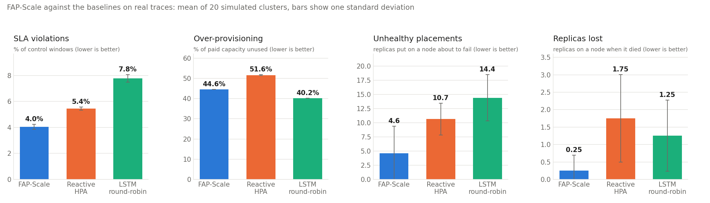
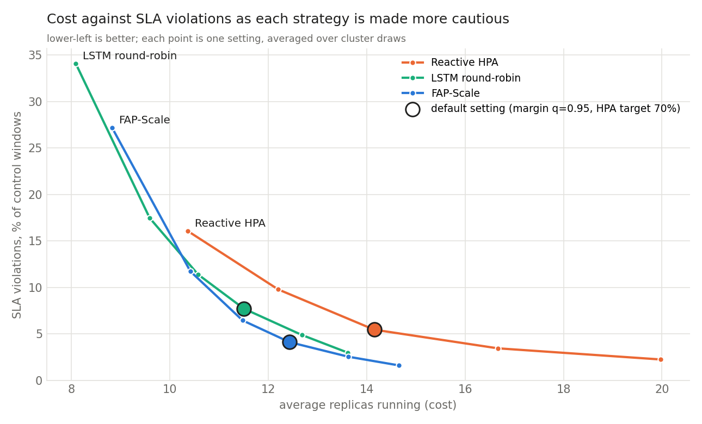
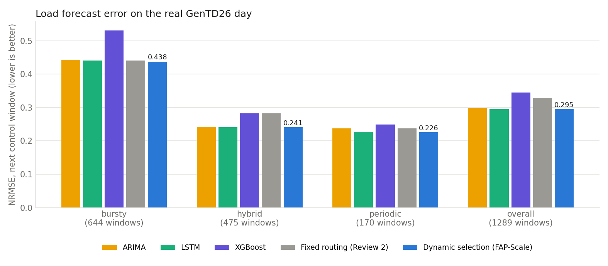
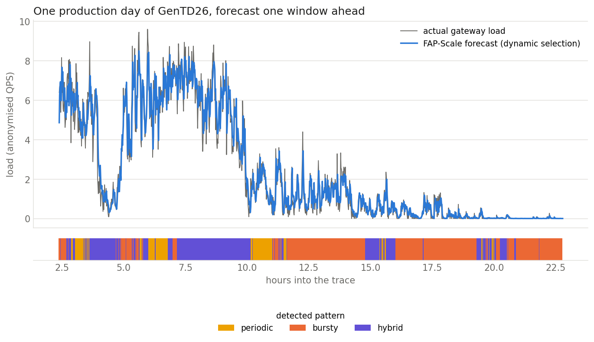
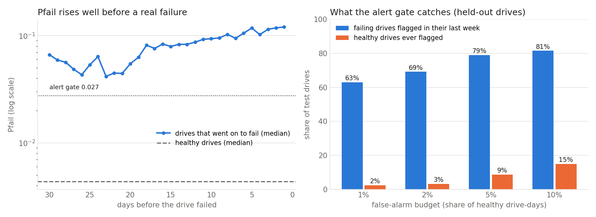

# FAP-Scale: Failure-Aware Predictive Autoscaling Framework

FAP-Scale decides **how many replicas** a service needs and **which nodes** they should run on in one step, every 60 seconds. It combines workload pattern classification, load forecasting with dynamic model selection, LightGBM node-failure prediction, and a 15-bin co-location interference matrix in a single fusion control loop.

Since Review 2 the project runs on **official 2026 datasets instead of self-generated data**.

| | Dataset | Supplies |
|---|---|---|
| Workload | [Alibaba GenTD26](https://github.com/alibaba/clusterdata/tree/master/cluster-trace-v2026-GenAI) (`cluster-trace-v2026-GenAI`, Alibaba Open Cluster Trace Program) | load, node utilisation, queueing, interference: one production day of a GenAI serving system at 57 s resolution, plus a 23-day request log |
| Failures | [Backblaze Drive Stats Q2 2026](https://www.backblaze.com/cloud-storage/resources/hard-drive-test-data) | node health telemetry and real node failures: 21.5 million drive-days, 862 failures |

Google has not released a cluster trace since 2019, which is why neither dataset is from Google. Provenance, terms and column meanings are in [data/README.md](data/README.md).

---

## Results on real data

All numbers below are produced by `python -m results.evaluate_real` and stored in [results/real/](results/real/).

### FAP-Scale against the baselines

Mean of 20 simulated clusters, 1,291 control windows each. Every strategy faces exactly the same clusters.

| Strategy | SLA violations | Unserved demand | Over-provisioning | Avg. replicas | Unhealthy placements | Replicas lost |
|:---|:---:|:---:|:---:|:---:|:---:|:---:|
| **FAP-Scale (proposed)** | **52.2** (4.0 %) | 1.21 % | 44.6 % | 12.44 | **4.6** | **0.25** |
| Reactive HPA (baseline 1) | 70.3 (5.4 %) | 1.15 % | 51.6 % | 14.19 | 10.7 | 1.75 |
| LSTM round-robin (baseline 2) | 100.4 (7.8 %) | 2.28 % | 40.2 % | 11.51 | 14.4 | 1.25 |

- **SLA violations**: control windows in which the capacity actually delivered (replicas that were up, minus what interference cost them) was below the demand.
- **Unserved demand**: share of all demand that found no capacity.
- **Over-provisioning**: share of the capacity paid for that went unused.
- **Unhealthy placements**: replicas placed on a node that then failed within 7 (replayed) days, judged against which nodes really failed.
- **Replicas lost**: replicas that were on a node at the moment it died.



**Against Reactive HPA**, FAP-Scale has 26 % fewer SLA violations while running 12 % fewer replicas (44.6 % over-provisioning against 51.6 %), 57 % fewer unhealthy placements and 86 % fewer lost replicas. It was at least as good on SLA violations and over-provisioning in all 20 clusters, and on unhealthy placements and lost replicas in 19. Unserved demand is level (1.21 % against 1.15 %): FAP-Scale misses in fewer windows, HPA's larger fleet makes its misses shallower.

**Against LSTM round-robin**, FAP-Scale has 48 % fewer SLA violations (fewer in all 20 clusters), about half the unserved demand, 68 % fewer unhealthy placements and 80 % fewer lost replicas. Its over-provisioning is *higher*, 44.6 % against 40.2 %, in every cluster. LSTM round-robin runs about 8 % fewer replicas because it sizes for the forecast alone and ignores the capacity replicas lose to interference, which is also why it misses the SLA nearly twice as often. The fair comparison between the two is at equal cost, next.

### Cost against SLA violations

Over-provisioning and SLA violations trade off: any autoscaler can buy fewer violations with more replicas. So each strategy was also run across its whole range of caution (the margin quantile for the two predictive scalers, the utilisation target for HPA).



SLA violations (% of windows) when every strategy is given the same budget:

| Replica budget | FAP-Scale | Reactive HPA | LSTM round-robin |
|:---|:---:|:---:|:---:|
| 14.19 replicas (what Reactive HPA uses at its 70 % target) | **2.03 %** | 5.42 % | 2.97 % |
| 11.51 replicas (what LSTM round-robin uses at its default margin) | **6.38 %** | 12.16 % | 7.71 % |

(Read off each strategy's curve by linear interpolation between the settings that were run; the settings themselves are in [results/real/tradeoff.csv](results/real/tradeoff.csv).)

For the same money FAP-Scale has the fewest violations: 63 % fewer than Reactive HPA and 32 % fewer than LSTM round-robin at the larger budget, 48 % and 17 % fewer at the smaller one. Its curve is below Reactive HPA's everywhere. It is below LSTM round-robin's for budgets above roughly 10 replicas, which is every setting with under about 12 % violations; at the most aggressive settings, where both miss the SLA in 17 to 34 % of windows, the two curves cross and LSTM round-robin is slightly ahead.

### Load forecasting: single models against dynamic selection

NRMSE of the next-window forecast over the whole GenTD26 day (lower is better).

| Pattern | Windows | Persistence | ARIMA | LSTM | XGBoost | Fixed routing (Review 2) | **Dynamic selection** |
|:---|:---:|:---:|:---:|:---:|:---:|:---:|:---:|
| bursty | 644 | 0.4576 | 0.4432 | 0.4406 | 0.5309 | 0.4406 | **0.4378** |
| hybrid | 475 | 0.2392 | 0.2417 | 0.2411 | 0.2831 | 0.2831 | **0.2410** |
| periodic | 170 | 0.2319 | 0.2376 | 0.2271 | 0.2489 | 0.2376 | **0.2258** |
| overall | 1289 | 0.2986 | 0.2991 | 0.2957 | 0.3455 | 0.3278 | **0.2949** |



- **Dynamic selection has the lowest error of the forecasters in every pattern and overall**, but by very little: 0.2949 against 0.2957 for the best single model (the LSTM), a 0.3 % difference. What it really buys is not having to know in advance which model is best.
- **It is 10 % better than the fixed routing table from Review 2** (0.3278). That table sends hybrid windows to XGBoost, which is the weakest model on this trace. Dynamic selection starts from the same table, scores every model after each window, and ends up trusting the LSTM most in 58 % of windows, ARIMA in 39 % and XGBoost in 3 %.
- **The LSTM had to be retrained.** The Review-2 LSTM, trained on synthetic bursts, scores 0.5822 on this day. The same network trained on the real 23-day request log scores 0.2957.
- **Minute-level load on this trace is close to a random walk.** Simply repeating the last value ("Persistence") scores 0.2986, and is marginally the best of all on hybrid windows. Over the whole day no model beats it by more than 1.3 % (4.3 % on bursty windows), so forecast accuracy is not where the strategies differ here.



### Node failure prediction

LightGBM on S.M.A.R.T. telemetry, tested on drives it never saw in training.

| | |
|:---|:---|
| Drives: train / calibration / test | 3,060 / 1,020 / 1,021, each drive in exactly one part (173 of the test drives failed) |
| Label | the drive fails within the next 7 days |
| ROC-AUC on the test drives | **0.891** |
| Failing drives flagged during their last week | **79 %** |
| First flag, median | 19 days before the failure (the sample only goes back 61 days) |
| Healthy drive-days flagged (false alarms) | 4.8 % |
| Healthy drives flagged at least once | 8.6 % |

The alert gate (`Pfail ≥ 0.027`) is set on the calibration drives to flag at most 5 % of healthy drive-days. The budget is generous on purpose: acting on a false alarm costs one replica migration with no downtime, a miss costs the replica.

| False-alarm budget | Failing drives flagged in their last week | Healthy drives ever flagged |
|:---:|:---:|:---:|
| 1 % | 63 % | 2.4 % |
| 2 % | 69 % | 3.2 % |
| **5 % (used)** | **79 %** | **8.6 %** |
| 10 % | 82 % | 15.0 % |



Two caveats. About one failing drive in five gives no warning the model can use: 71 % of drives had a non-zero error counter the day before they failed (against 6 % of healthy drive-days), the rest looked clean. And failures are rare in the real fleet (862 of about 355,000 drives in 61 days), so even at this ROC-AUC most flags are false alarms: re-weighted to the fleet, only 0.3 % of flagged drive-days are followed by a failure within a week. That is acceptable only because acting on a flag is cheap.

### What each part contributes

FAP-Scale with one part switched off at a time (same 20 clusters):

| Variant | SLA violations | Avg. replicas | Unhealthy placements | Replicas lost |
|:---|:---:|:---:|:---:|:---:|
| FAP-Scale (full) | 52.2 | 12.44 | 4.6 | 0.25 |
| without failure awareness | 51.4 | 12.43 | 17.9 | 1.20 |
| without interference awareness | 92.2 | 11.48 | 3.0 | 0.20 |
| with the LSTM forecast only | 50.1 | 12.49 | 4.0 | 0.15 |

- **Failure awareness** is what cuts unhealthy placements (17.9 → 4.6) and lost replicas (1.20 → 0.25). It does *not* change SLA violations (51.4 against 52.2). Replicas are spread one per node, so a node failure strands at most one replica of a roughly 12-replica service, and the safety margin absorbs that.
- **Interference awareness** is what cuts SLA violations (92.2 → 52.2). Most of this is sizing: knowing that co-located replicas lose capacity, FAP-Scale runs 8 % more replicas. At the same replica budget the gain is smaller, 6.44 % of windows violated with it against 7.14 % without.
- **Dynamic model selection** makes no measurable difference to the closed loop on this trace (52.2 against 50.1 violations, at 12.44 against 12.49 replicas), which matches the forecasters being within 1 % of each other.

### What these results do not show

- **FAP-Scale does not win every column.** LSTM round-robin has lower over-provisioning in all 20 clusters, and Reactive HPA has marginally less unserved demand. Both are discussed above; the claim that holds is "fewest SLA violations at any given cost in the range anyone would run", not "best on every metric at default settings".
- **Unhealthy placements are not zero.** Review 2 reported 0 on synthetic data, where failing nodes were generated to look sick. Real failures are harder: 21 % of failing drives were not flagged in their last week.
- **The failure rate is injected.** 7 of 72 nodes fail per run, and 30 days of drive history are replayed over one day of workload because the two traces have different time scales. The failure *trajectories* are real; how often failures happen in a run is a parameter.
- **Interference is a proxy.** GenTD26 does not record which host a pod ran on, so true co-location is not observable. A replica is assumed to lose the same share of throughput as the tenant pod on its node was losing to latency inflation in that window. The tenants are also near-identical (one service behind a load balancer), which leaves placement little to choose between; a mixed-tenant cluster would be a stronger test.
- **Two different systems are joined.** Workload comes from a GPU serving cluster, failures from storage drives. A "node" in the simulation is a composition of the two, not a machine either dataset observed.
- **One day, one service.** The 20 runs vary the hardware, not the workload. Load is in Alibaba's anonymised QPS units.
- **Three planned signals are in no public trace**: context-switch rate, DIMM errors and network retransmissions. [data/README.md](data/README.md) lists what stands in for each.
- **FAP-Scale starts cold.** Its safety margin and interference matrix are learned during the run, so the first stretch is its weakest. Over only the first 150 windows of cluster 0 (`python main.py --windows 150`) Reactive HPA has fewer SLA violations (4 against 12) while running 28 % more replicas. The figures above are for the whole day.
- **Controllers act once per 57 s window.** A real HPA re-evaluates every 15 s; new replicas would still need the cold start.
- **Review-2 numbers are not comparable.** They came from generated data with a different simulator, in which forecasts could see the window they were predicting and the HPA baseline scaled on a signal unrelated to the load.

---

## How it works

Every control window (57 s on the GenTD26 trace):

1. **Classify** the recent load as periodic, bursty or hybrid from four features: autocorrelation peaks, wavelet energy ratio, coefficient of variation, Hurst exponent.
2. **Forecast** the next windows with ARIMA, LSTM and XGBoost. Dynamic selection starts from the routing table (periodic → ARIMA, bursty → LSTM, hybrid → XGBoost), scores every model after each window, and blends them by tracked error, so the routing follows the data.
3. **Score every node**: `Pfail` from LightGBM on the node's hardware telemetry, `IS` from the interference matrix for the node's tenant profile, `U` from its utilisation.

   `S(i) = α(1 − Pfail) + β(1 − IS) + γ(1 − U/100)` with α = 0.40, β = 0.35, γ = 0.25
4. **Decide scale and placement together**: nodes whose `Pfail` reaches the alert gate are excluded; the rest are ranked by `S(i)`; `K` is the smallest number of replicas whose expected capacity on the nodes they will actually run on, `Σ capacity × (1 − IS(i))`, covers the forecast plus a safety margin. With no interference this is `K = ⌈load / capacity⌉`.
5. **Act and learn**: add or remove replicas, drain any replica on a node that failed the gate (replacement first), and feed the slowdown each node just experienced back into the interference matrix: `IS_new = (1 − α)·IS_old + α·observed`, α = 0.1.

### The baselines

- **Reactive HPA**: the Kubernetes Horizontal Pod Autoscaler algorithm with a 70 % utilisation target, the 10 % tolerance band and the 5-minute scale-down stabilisation window; round-robin placement.
- **LSTM round-robin**: LSTM forecast plus the same safety margin as FAP-Scale; round-robin placement, no health or interference awareness.

### The simulated cluster

Built from the two traces in [simulator/cluster.py](simulator/cluster.py); nothing is drawn from a random distribution. A seed only decides which real drive backs which node and when in the run its history is placed.

- 72 nodes. Each hosts one GenTD26 pod and carries that pod's GPU utilisation, memory use, queue time, and the latency inflation it experienced, which is the throughput a co-located replica loses.
- Each node replays the S.M.A.R.T. history of one real drive from the held-out test split. 7 nodes per cluster are backed by drives that really failed, and go down on the day their drive did.
- Replica capacity, 0.34 QPS, is read off the trace (QPS served per saturated GPU), not assumed.
- Kubernetes mechanics apply to every strategy alike: a new replica serves one window after it is requested, a dead node is marked NotReady one window later, and replicas stranded on it are evicted after the default 5-minute toleration.

---

## 📁 Repository Structure

```
fap-scale/
├── traces/
│   ├── gentd26.py                  # Alibaba GenTD26: download, verify, parse to one grid
│   ├── backblaze.py                # Backblaze Drive Stats Q2 2026: build and load the sample
│   └── http_range.py               # seekable reader over HTTP range requests
├── data/
│   ├── README.md                   # dataset provenance, terms, columns
│   ├── processed/                  # Backblaze sample (committed, 1.8 MB)
│   └── raw/                        # GenTD26 files (downloaded, git-ignored)
├── models/
│   ├── pattern_classifier.py       # 4-feature Workload Pattern Classifier (Person A)
│   ├── forecasters.py              # ARIMA / LSTM / XGBoost Forecasters (Person A)
│   ├── load_pipeline.py            # classify → select → forecast API, DynamicSelector, ForecastMargin (Person A)
│   ├── train_real.py               # trains the LSTM on the GenTD26 request log (Person A)
│   ├── artifacts/                  # lstm_gentd26.pt (real), lstm_bursty.* (synthetic)
│   └── node_health/
│       ├── failure_scorer.py       # LightGBM Failure Scorer, CPI, TTS, S.M.A.R.T. features (Person B)
│       ├── interference.py         # 15-bin Co-location Interference Matrix + EMA (Person B)
│       └── train_real.py           # trains and evaluates the scorer on Backblaze (Person B)
├── fusion/
│   └── fusion_engine.py            # S(i), health gate, joint sizing, EMA feedback (Person C)
├── simulator/
│   ├── cluster.py                  # trace-driven cluster simulator (Person C)
│   ├── policies.py                 # the three strategies as simulator policies (Person C)
│   └── baselines.py                # Reactive HPA & LSTM-RoundRobin (Person C)
├── results/
│   ├── evaluate.py                 # metrics and comparison chart
│   ├── evaluate_real.py            # full evaluation on the real traces
│   ├── real/                       # results on real data (tables, charts, summary.json)
│   ├── evaluate_load_side.py       # Review-2 load-side evaluation on synthetic windows
│   └── load_side/                  # Review-2 synthetic results, kept for reference
├── tests/
│   ├── test_traces.py              # dataset loaders (10 tests)
│   ├── test_real_data.py           # real-data models, fusion, simulator (38 tests)
│   ├── test_person_b.py            # Person B unit tests (6 tests)
│   ├── test_person_c.py            # Person C unit + integration tests (42 tests)
│   └── test_load_side.py           # Person A load pipeline tests (15 tests)
├── main.py                         # end-to-end simulation on the real traces
├── demo_synthetic.py               # the Review-2 demo on self-generated data
├── demo_load_side.py               # Person A live classification demo
├── INTERFACE.md                    # Person A → C interface contract
├── requirements.txt
└── README.md
```

---

## 👥 Module Ownership & Responsibilities

| Team Member | Module Files | Core Responsibilities & Deliverables |
| :--- | :--- | :--- |
| **Person A (Nirupam)** | `models/pattern_classifier.py`<br>`models/forecasters.py`<br>`models/load_pipeline.py`<br>`models/train_real.py` | • Compute 4 features (Autocorr peaks, Wavelet energy, CV, Hurst exp).<br>• Classify workload pattern (`periodic`, `bursty`, `hybrid`).<br>• ARIMA, LSTM, XGBoost load forecasting with dynamic model selection.<br>• **Deliverable**: `classify_and_forecast(window) → dict` with `pattern`, `predicted_load`, `model_used` |
| **Person B (Adarsh)** | `traces/backblaze.py`<br>`models/node_health/failure_scorer.py`<br>`models/node_health/interference.py`<br>`models/node_health/train_real.py` | • Real per-node hardware telemetry with real failures.<br>• Compute CPI and TTS health indicators.<br>• Train LightGBM model to predict node failure probability P_fail.<br>• Maintain 15-bin Co-location Interference Matrix with EMA (α=0.1).<br>• **Deliverables**:<br>  `score_node_failure(node_id, telemetry) → Pfail`<br>  `get_interference(type_i, type_j) → IS` |
| **Person C (Aman)** | `fusion/fusion_engine.py`<br>`simulator/cluster.py`<br>`simulator/policies.py`<br>`simulator/baselines.py`<br>`main.py` | • Compute composite node placement score S(i) = α(1−P_fail) + β(1−IS) + γ(1−U).<br>• Decide replica count K and placement jointly.<br>• Execute the 60s window control loop with EMA feedback.<br>• Implement Reactive HPA and LSTM Round-Robin baselines.<br>• End-to-end integration of all modules. |

---

## 🚀 Quickstart & Execution

### 1. Install Dependencies
```bash
pip install -r requirements.txt
```

### 2. Download the workload trace (once, 5 MB)
```bash
python -m traces.gentd26
```
The Backblaze sample is already in the repository. To rebuild it from the official archive (streams about 1.5 GB): `python -m traces.backblaze`.

### 3. Run All Tests (111 tests)
```bash
python -m pytest tests/ -v
```

### 4. Run End-to-End Simulation
```bash
python main.py                  # one simulated cluster, the whole trace day
python main.py --seed 3         # a different draw of node hardware
```
This trains the failure model on the real drives, assembles a cluster from the two traces, and runs **FAP-Scale**, **Reactive-HPA** and **LSTM-RoundRobin** against it.

### 5. Reproduce the results in this README
```bash
python -m results.evaluate_real             # 20 clusters, about 10 minutes
```
To retrain from scratch first: `python -m models.train_real` (LSTM) and delete `results/real/forecast_raw.csv` (the cached forecasts, about 9 minutes to rebuild).

### 6. Review-2 material on synthetic data
```bash
python demo_synthetic.py            # the original self-generated-data demo
python demo_load_side.py            # Person A live classification demo
python results/evaluate_load_side.py
```

---

## Dataset citations

- Y. Lin et al., "Understanding Diffusion Model Serving in Production: A Top-Down Analysis of Workload, Scheduling, and Resource Efficiency," ACM SoCC '25. Dataset: GenTD26, `cluster-trace-v2026-GenAI`, Alibaba Open Cluster Trace Program.
- Y. Lin et al., "FlexPipe: Adapting Dynamic LLM Serving Through Inflight Pipeline Refactoring in Fragmented Serverless Clusters," EuroSys '26.
- Backblaze, "Drive Stats," Q2 2026 data release, https://www.backblaze.com/cloud-storage/resources/hard-drive-test-data.
